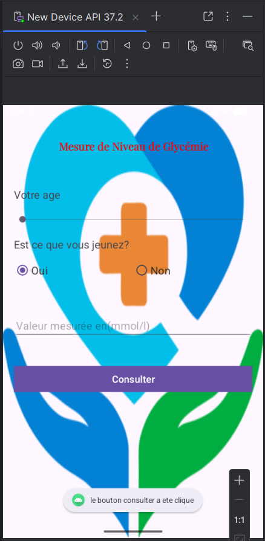
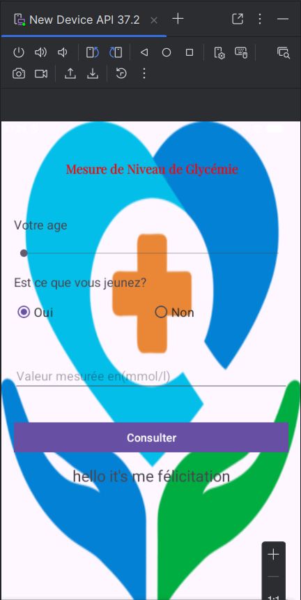

# Nom_Prénom_LSI3_Mesure_Glycémie

**TP2 : Création d'interface utilisateur**
Matière : Développement Mobile | Filière : LSI3 | Année universitaire : 2026-2027
Enseignante du cours : Sahar Dammak | Enseignante TP : Fourati Héla

---

## Description

Application Android (Java) qui aide un patient diabétique à mesurer son niveau de glycémie. Le patient renseigne :

- son **âge** (`SeekBar`, de 1 à 120 ans) ;
- la **valeur mesurée** en mmol/L (`EditText`) ;
- s'il est **à jeun** ou non (`RadioGroup` avec deux `RadioButton` : Oui / Non).

Un clic sur le bouton **CONSULTER** appelle la méthode `calculer()` qui affiche le résultat dans un `TextView`.

## Règles d'interprétation

| Situation | Catégorie | Intervalle normal (mmol/L) |
|---|---|---|
| À jeun | Adultes et enfants de plus de 13 ans | 5,0 à 7,2 |
| À jeun | Enfants de 6 à 12 ans | 5,0 à 10,0 |
| À jeun | Enfants de moins de 6 ans | 5,5 à 10,0 |
| Après repas | Adultes et enfants | < 10,5 |

Messages affichés : « niveau de glycémie est normale », « niveau de glycémie est trop bas » ou « niveau de glycémie est trop élevée ».

---

## Configuration du projet

| Paramètre | Valeur |
|---|---|
| Modèle | Empty View Activity |
| Nom | Nom_Prénom_Mesure_Glycémie |
| Langage | Java |
| SDK minimal | API 24 (Android 7.0) |
| Activité | `MainActivity` |

## Structure du projet

```
app/src/main/
├── java/.../MainActivity.java
└── res/
    ├── layout/activity_main.xml
    ├── drawable/        (image de fond)
    ├── font/            (playfair_display)
    └── values/colors.xml
```

---

## Interface (phase 2)

- **LinearLayout** vertical : `match_parent`, padding 20dp, image de fond.
- **Titre** (`TextView`) : centré, padding 30dp, police `playfair_display`, couleur rouge, 25sp, gras.
- **SeekBar** `sbAge` : max 120, marge haute 20dp.
- **RadioGroup** horizontal : `rbtOui` (coché par défaut) et `rbtNon`.
- **EditText** : indice « valeur mesurée (en mmol/l) », type `numberDecimal`, 25sp, marge haute 20dp.
- **Button** `btnConsulter` : centré, texte « CONSULTER » 18sp, marge haute 20dp, `onClick` = `calculer`.

---

## Captures d'écran
1.pour la methode de la message dans un remarque:

2.pour la methode Onclick:


### Méthode onClick

### Toast.makeText

---

## Lancer le projet

1. Cloner le dépôt GitHub.
2. Ouvrir le dossier avec Android Studio.
3. Attendre la synchronisation Gradle.
4. Lancer l'application sur un émulateur ou un appareil (API 24+).

## Auteur

**Nom Prénom** : LSI3, Département d'informatique et de communication
